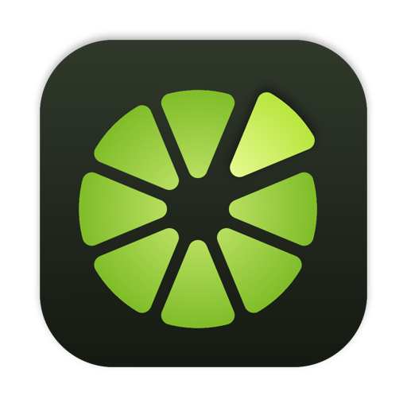
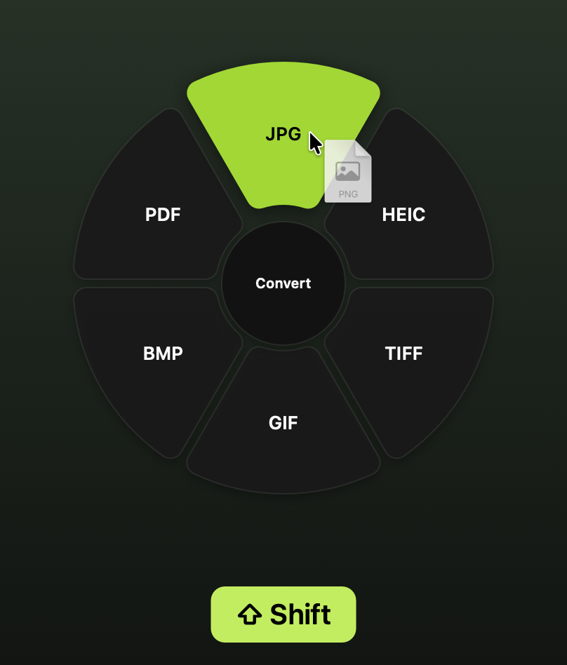
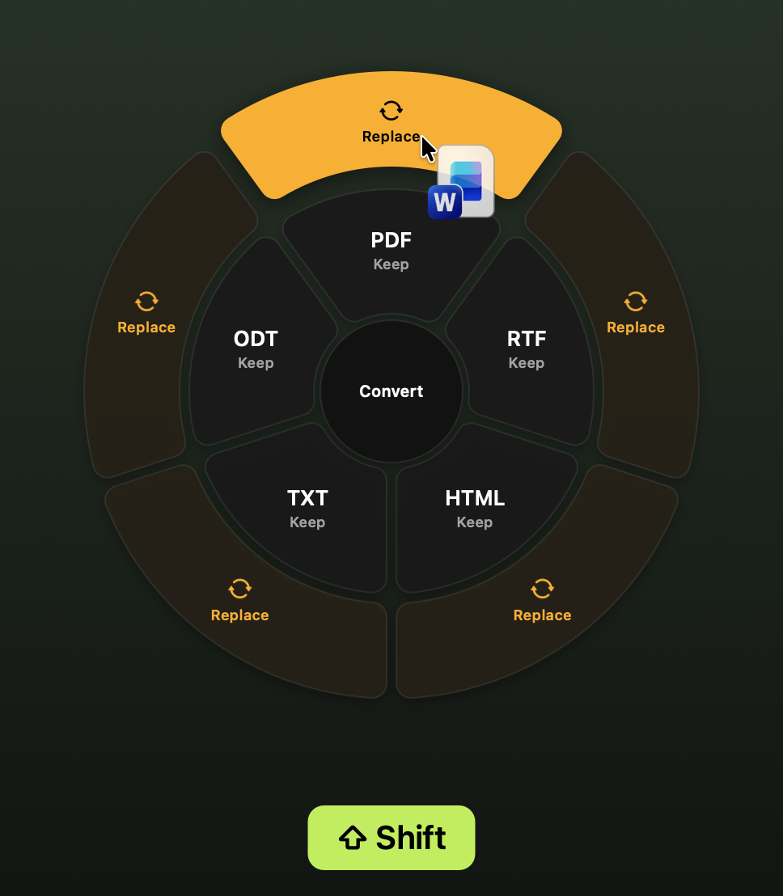
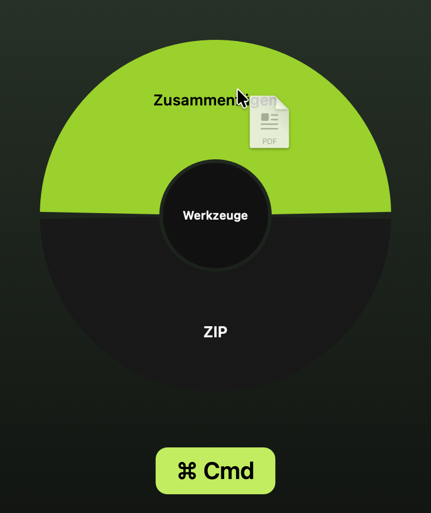
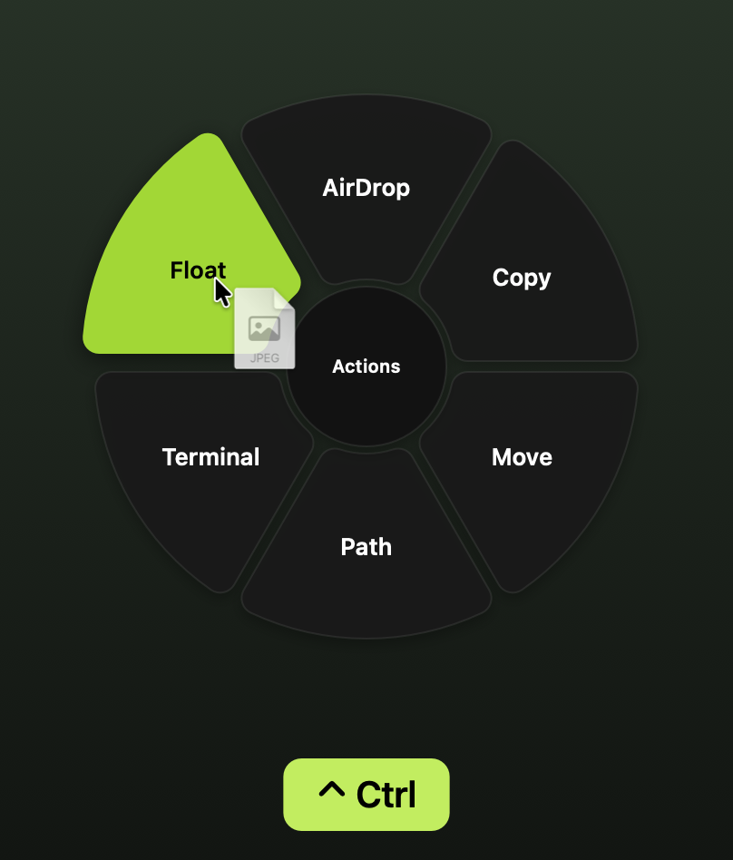
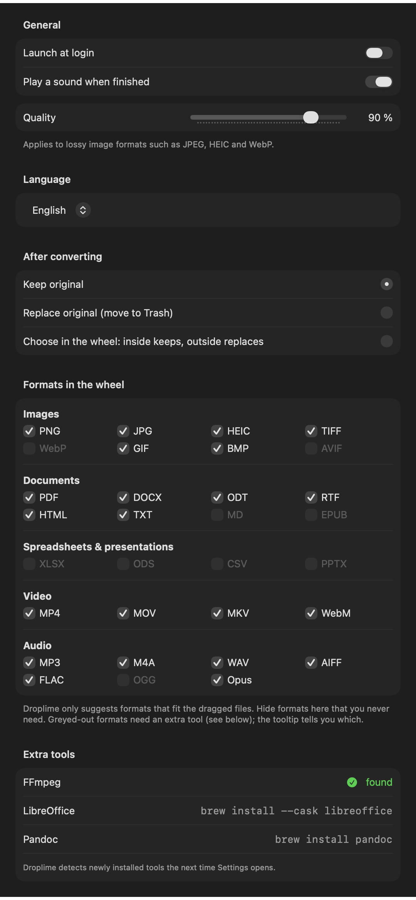

<p align="center">
  
</p>

<h1 align="center">Droplime</h1>

<p align="center">
  <b>Drag. Tap. Drop.</b><br>
  Convert, edit and share files right while you drag them, without opening a single window.
</p>

<p align="center">
  
  
  
  
  
</p>

<p align="center">
  
</p>

---

Droplime lives quietly in your menu bar. While you drag a file (from Finder, the desktop or almost any app), tap a key and a wheel opens at your cursor with exactly the options that fit that file. Release the file on a segment and the result appears right next to the original.

| Key while dragging | Wheel | What for |
|---|---|---|
| <kbd>⇧ Shift</kbd> | **Convert** | turn it into another format |
| <kbd>⌘ Cmd</kbd> | **Tools** | resize, merge, strip metadata, zip … |
| <kbd>⌃ Ctrl</kbd> | **Actions** | AirDrop, copy, move, path, Terminal, Float |

Tapping another key switches the wheel. Releasing in the center or outside the wheel cancels, and the file lands wherever you dragged it, as usual.

## Contents

- [Convert](#convert)
- [Keep or replace the original](#keep-or-replace-the-original)
- [Tools](#tools)
- [Actions](#actions)
- [Settings](#settings)
- [Privacy](#privacy)
- [Installation](#installation)
- [Development](#development)
- [Limitations and plans](#limitations-and-plans)

## Convert



The wheel only shows formats the dragged file can **actually** be converted to. The current format is left out, and with several files only the formats that work for all of them remain.

Built in, no extra software needed:

- **Images**: reads PNG, JPG, HEIC, TIFF, GIF, BMP, SVG and RAW → PNG, JPG, HEIC, TIFF, GIF, BMP, **PDF**
- **PDF** → PNG or JPG (one file per page), **TXT** (extract the text)
- **Text documents**: DOCX, DOC, ODT, RTF, HTML, TXT → DOCX, ODT, RTF, HTML, TXT, **PDF**
- **Video**: MP4, MOV, M4V → MP4, MOV, **M4A** (audio only)
- **Audio**: MP3, M4A, WAV, AIFF, FLAC, CAF → M4A, WAV, AIFF

<br clear="right">

Optional extra tools make the wheel bigger. Droplime finds them automatically and only offers what actually works with the installed version:

| Tool | Install | Adds |
|---|---|---|
| [FFmpeg](https://ffmpeg.org) | `brew install ffmpeg` | MKV, WebM, animated GIF from video, MP3, FLAC, Opus, OGG, and videos in formats macOS can't read itself |
| [LibreOffice](https://www.libreoffice.org) | `brew install --cask libreoffice` | faithful DOCX → PDF, spreadsheets (XLSX, ODS, CSV), presentations (PPTX → PDF) |
| [Pandoc](https://pandoc.org) | `brew install pandoc` | Markdown ↔ DOCX, HTML, ODT, EPUB |

If a file name is already taken, you get `Name 2.jpg`. Droplime never overwrites anything.

## Keep or replace the original



In Settings you decide what happens to the original:

- **Keep original** *(default)*: the new file is added.
- **Replace original**: the original goes to the Trash.
- **Choose in the wheel**: every segment is split in two. The **inner** ring (*Keep*) adds the new file, the **outer** amber ring (*Replace*) swaps the original for it. You decide on every drop.

Safety net: replaced originals **always go to the Trash** and are never deleted for good. If a conversion fails, the original stays untouched, and with several files this applies to each one individually.

<br clear="right">

## Tools



The tools wheel adapts too: two PDFs offer *Merge*, a photo offers *Resize* and *Strip Metadata*. Tools always create a **new** file and leave the original alone.

| Files | Tool | Result |
|---|---|---|
| Images | **Resize** | half the width and height, `Photo (small).jpg` |
| | **Rotate** | 90° clockwise |
| | **Strip Metadata** | removes location (GPS), camera data and XMP, losslessly; orientation is kept |
| PDF | **Split** | one PDF per page |
| | **Compress** | images inside the PDF downsampled |
| | **Rotate** | all pages by 90° |
| several PDFs and images | **Merge** | one PDF, in the order of the selection |
| Video | **Compress** | HEVC, at most 1080p, usually a fraction of the size |
| | **Remove Audio** | audio track removed, video untouched |
| Audio | **Compress** | AAC at 96 kbit/s |
| anything, including folders | **ZIP** | like “Compress” in Finder; several items become `Archive.zip` |
| ZIP | **Unzip** | into a folder next to it |

<br clear="right">

## Actions



Actions work with everything: files, folders, mixed selections.

- **AirDrop**: opens the AirDrop picker right away.
- **Copy / Move**: asks for the destination folder (and remembers the last one). Files with the same name are never overwritten.
- **Path**: copies the full path to the clipboard, one per line for several files.
- **Terminal**: opens the file's folder in Terminal.
- **Float**: parks the file in a small always-on-top preview window. Drag it out again whenever you need it: into an email, an upload, or back into the Droplime wheel with <kbd>⇧</kbd>.

<br clear="right">

## Settings



Lime icon in the menu bar → **Settings …** (<kbd>⌘ ,</kbd>):

- **Language**: English or German. On first launch Droplime follows the system language (German on a German system, English otherwise); switching takes effect immediately, no restart.
- **After converting**: keep, replace, or choose in the wheel (see above).
- **Formats in the wheel**: untick formats you never need and they won't show up again. Smart suggestions stay: only formats that fit the file *and* are ticked appear.
- **Extra tools**: shows whether FFmpeg, LibreOffice and Pandoc were found and how to install them. Hover over a greyed-out format to see which tool unlocks it.

<br clear="right">

## Privacy

- **Everything happens on your Mac.** Droplime has no networking code: no uploads, no accounts, no telemetry.
- **No special permissions.** Droplime notices drags and key taps without Accessibility or Screen Recording access.
- **Nothing gets lost.** Originals are only replaced if you ask for it, and then go to the Trash.

## Installation

Requirements: macOS 14 (Sonoma) or later, Xcode or the Swift toolchain.

A ready-built ZIP is attached to each [GitHub Release](https://github.com/domi-bg/droplime/releases). Droplime is not notarized, so on first launch macOS may refuse to open it. Right-click the app and choose *Open*, or run `xattr -d com.apple.quarantine /Applications/Droplime.app`.

```bash
git clone https://github.com/domi-bg/droplime.git
cd droplime
./scripts/build-app.sh
open build/Droplime.app
```

You can move `build/Droplime.app` to `/Applications`. To start Droplime at login: *System Settings → General → Login Items* → add Droplime.

For more formats (optional):

```bash
brew install ffmpeg pandoc
brew install --cask libreoffice
```

Then restart Droplime.

## Development

```bash
swift run      # run directly, log output goes to the terminal
swift test     # tests: real sample files through every format and every tool
```

| Path | Contents |
|---|---|
| `Sources/Droplime/DragWatcher.swift` | detects file drags and key taps system-wide |
| `Sources/Droplime/WheelPanel.swift` | the wheel at the cursor, dropping, split segments |
| `Sources/Droplime/Conversion/` | one `Converter` per engine (ImageIO, PDFKit, textutil, AVFoundation, FFmpeg, LibreOffice, Pandoc) |
| `Sources/Droplime/Tools/` | tools (`Tool`) for images, PDFs, media, archives |
| `Sources/Droplime/Actions/` | actions and the Float window |
| `Sources/Droplime/Localization.swift` | every visible string, once per language |
| `Sources/Droplime/LimeIcon.swift` | app and menu bar icon, drawn in code |
| `scripts/` | build the app, regenerate the icon and the README images |

**New format:** implement `Converter` (`targets(for:)`, `convert(_:to:output:)`) and add it in `AppDelegate`. The order of that list decides which converter wins when several offer the same format.
**New tool:** implement `Tool` (`applies(to:)`, `run(_:)`) and add it to `ToolService.standard()`.
**Texts and translations:** all visible strings live in `Sources/Droplime/Localization.swift`, once per language. A missing translation fails the build.

Regenerate images with `./scripts/make-icon.sh` (app icon) and `./scripts/make-screenshots.sh` (the images in this README).

## Limitations and plans

- Tools that need a selection, like **trimming** a video or **cropping** an image, need a small UI and aren't there yet.
- The keys are fixed (Shift, Cmd, Ctrl) and can't be changed yet.
- Long conversions don't show progress yet; a sound tells you when they're done.
- The wheel shows at most 10 entries, and their order can't be customized yet.

Ideas and pull requests are welcome.

## License

[MIT](LICENSE)
